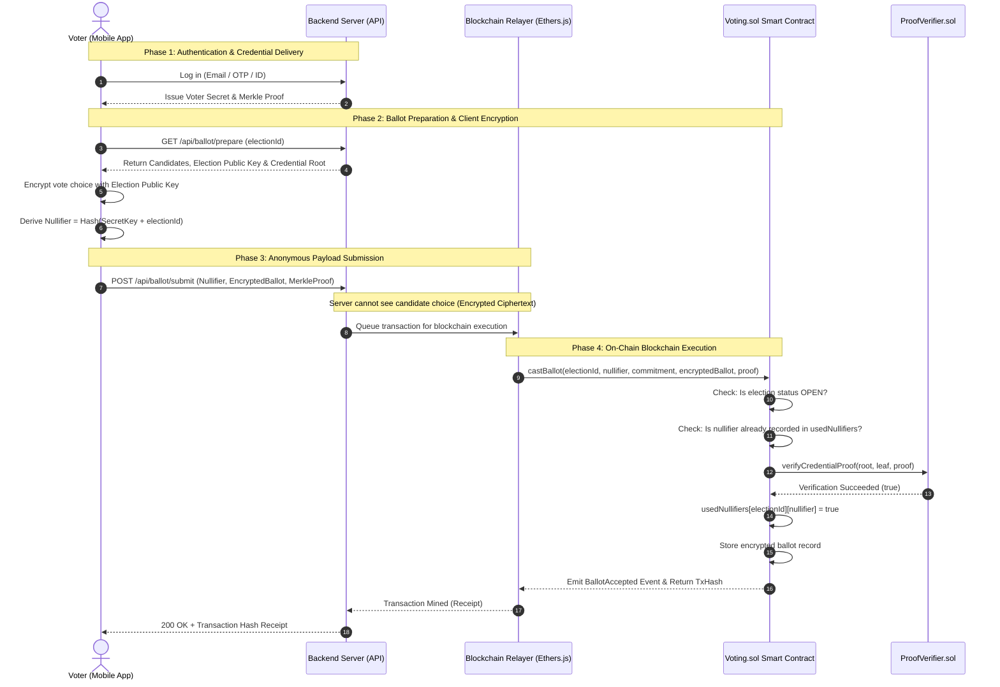

# Blockchain-Based Voting System: Comprehensive Architecture & Flow Guide

> **Academic Project Reference & Technical Documentation**  
> Covers: Blockchain Architecture, Smart Contracts, Cryptographic Privacy, Gasless Relayer, and End-to-End System Flow.

---

## Table of Contents
1. [Project Overview](#1-project-overview)
2. [Which Blockchain is Used?](#2-which-blockchain-is-used)
3. [The 4 Smart Contracts in Detail](#3-the-4-smart-contracts-in-detail)
4. [Cryptographic Principles & Privacy Architecture](#4-cryptographic-principles--privacy-architecture)
5. [End-to-End System Flow (Sequence & Diagram)](#5-end-to-end-system-flow)
6. [Detailed Step-by-Step Walkthrough](#6-detailed-step-by-step-walkthrough)
7. [Security & Threat Mitigation](#7-security--threat-mitigation)
8. [Viva & Project Evaluation Quick Reference](#8-viva--project-evaluation-quick-reference)

---

## 1. Project Overview

This project is a **Decentralized, Privacy-Preserving Electronic Voting System** designed for secure digital elections.

Traditional electronic voting platforms store `(voter_identity, vote)` in a centralized database, leaving elections vulnerable to:
- **Server administrators altering vote counts**
- **Database leaks compromising ballot secrecy**
- **Voter coercion and vote-buying**

This system solves these vulnerabilities by combining:
1. **React Native Mobile App**: A mobile voting client for voters, administrators, and party observers.
2. **Node.js/Express Backend**: Handles user authentication, candidate registries, and acts as an **Anonymous Meta-Transaction Relayer**.
3. **EVM Smart Contracts**: An immutable on-chain voting ledger that guarantees mathematical fairness, prevents double voting, and keeps ballots tamper-proof.

---

## 2. Which Blockchain is Used?

### Ethereum Virtual Machine (EVM) Architecture
The project is built on **Ethereum Virtual Machine (EVM)** compatible blockchain infrastructure:

- **Smart Contract Language**: Solidity (`^0.8.28`) with OpenZeppelin security contracts.
- **Development & Local Testing**:
  - **Hardhat Local Ethereum Node** (`http://127.0.0.1:8545`)
  - **Network Chain ID**: `31337`
  - Provides instant deterministic block mining, zero-cost development gas, and local cryptographic contract execution.
- **Production & Testnet Compatibility**:
  - The contracts compile to standard EVM bytecode and can be deployed without code modification to:
    - **Public Ethereum Testnets**: Sepolia, Holesky
    - **Layer-2 Rollups**: Arbitrum, Optimism, Base, Polygon PoS (for sub-cent transaction fees and high throughput)
    - **Private / Consortium Enterprise Chains**: Hyperledger Besu, ConsenSys Quorum (ideal for university, municipal, or government-internal elections)

---

## 3. The 4 Smart Contracts in Detail

All smart contracts are located in `contracts/contracts/`:

```
contracts/contracts/
├── ElectionManager.sol    # Lifecycle & configuration of elections
├── ProofVerifier.sol      # Merkle membership verification (Zero-Knowledge style)
├── Voting.sol             # Receives encrypted ballots & enforces single-use nullifiers
└── TallyRegistry.sol      # Records certified on-chain election outcomes
```

### 1. `ElectionManager.sol`
* **Purpose**: Manages election parameters, timelines, and cryptographic commitments.
* **Key Functions & State**:
  - `createElection(...)`: Deploys an election with start time, end time, asymmetric encryption public key, and `credentialRoot`.
  - `openElection(electionId)`: Changes state from `CREATED` to `OPEN`.
  - `closeElection(electionId)`: Prevents any new ballots after the voting deadline.
  - `finalizeElection(electionId)`: Seals the election once tallies are verified.
  - Enforces status transitions (`CREATED` ➔ `OPEN` ➔ `CLOSED` ➔ `FINALIZED`).

### 2. `ProofVerifier.sol`
* **Purpose**: Provides trustless, on-chain proof of voter eligibility without revealing voter identity.
* **Mechanism**:
  - Takes voter commitment leaf: `leaf = Hash(SecretKey, Salt)`.
  - Takes Merkle sibling hashes: `merkleProof[]`.
  - Validates sorted `keccak256` hashing up to the registered `credentialRoot`:
    ```solidity
    if (computedHash < proofElement) {
        computedHash = keccak256(abi.encodePacked(computedHash, proofElement));
    } else {
        computedHash = keccak256(abi.encodePacked(proofElement, computedHash));
    }
    ```
  - Reverts with `MerkleRootMismatch` if the proof is forged or unlisted.

### 3. `Voting.sol`
* **Purpose**: Primary contract for collecting encrypted ballots and enforcing the "one person, one vote" rule.
* **Mechanism**:
  - Tracks `mapping(uint256 => mapping(bytes32 => bool)) public usedNullifiers;`
  - When `castBallot(...)` is called:
    1. Checks if election is `OPEN`.
    2. Validates that `usedNullifiers[electionId][nullifier] == false`.
    3. Calls `ProofVerifier.verifyCredentialProof(...)`.
    4. Marks `usedNullifiers[electionId][nullifier] = true`.
    5. Stores the encrypted ciphertext and emits `BallotAccepted`.

### 4. `TallyRegistry.sol`
* **Purpose**: Holds verified final counts and cryptographic decryption commitments once voting closes.
* **Mechanism**:
  - Enforces that tally submissions match the exact number of ballots stored on-chain.
  - Ensures election outcomes are immutable and publicly auditable forever.

---

## 4. Cryptographic Principles & Privacy Architecture

The system achieves both **absolute ballot secrecy** and **fraud resistance** through four cryptographic layers:

```
+-----------------------------------------------------------------------------------+
|  1. Merkle Tree Root (Eligibility without Identity)                              |
|     Voter commitment leaf = Hash(SecretKey, Salt)                                 |
|     All voter leaves are hashed into one Merkle Root published on-chain.          |
+-----------------------------------------------------------------------------------+
                                    |
                                    v
+-----------------------------------------------------------------------------------+
|  2. Deterministic Single-Use Nullifiers (Prevents Double Voting)                 |
|     Nullifier = Hash(VoterSecretKey + ElectionID)                                |
|     Every voter has exactly 1 deterministic nullifier per election.               |
|     The smart contract marks nullifiers as used without knowing who the voter is. |
+-----------------------------------------------------------------------------------+
                                    |
                                    v
+-----------------------------------------------------------------------------------+
|  3. Client-Side Ballot Encryption (Ballot Secrecy)                                |
|     The vote choice is encrypted on the voter's mobile device using the           |
|     election's public key BEFORE transmission over the network.                   |
+-----------------------------------------------------------------------------------+
                                    |
                                    v
+-----------------------------------------------------------------------------------+
|  4. Gasless Meta-Transaction Relayer (Zero Crypto Friction)                      |
|     Voters do NOT need MetaMask, ETH, gas tokens, or blockchain knowledge.        |
|     The backend acts as an anonymous sponsor relayer, funding on-chain gas fees.  |
+-----------------------------------------------------------------------------------+
```

---

## 5. End-to-End System Flow



---

## 6. Detailed Step-by-Step Walkthrough

### Phase 1: Election Initialization (Admin)
1. Administrator creates an election via the Admin Screen.
2. The system generates an asymmetric encryption keypair for this specific election.
3. Registered eligible voters are gathered.
4. Each voter's public commitment `Leaf = Hash(VoterSecret, Salt)` is generated.
5. A Merkle Tree is constructed from all leaves.
6. The resulting **`credentialRoot`** and the **`encryptionPublicKey`** are submitted to `ElectionManager.sol`.

### Phase 2: Voter Authentication & Setup
1. A voter opens the mobile application.
2. The voter logs in using their authenticated credentials.
3. The server provides the voter with their private credential slice and Merkle sibling path proving inclusion in the tree.

### Phase 3: Ballot Preparation & Encryption (Client-Side)
1. The voter opens the active ballot screen and views candidate profiles.
2. The voter selects their candidate.
3. **Client-side Encryption**: The mobile app encrypts the candidate choice using the election's public key. The plaintext choice never leaves the device.
4. **Nullifier Generation**: The mobile app computes the mathematical nullifier:
   $$\text{Nullifier} = \text{Hash}(\text{VoterSecret}, \text{electionId})$$
   Because this hash is deterministic, the voter will always generate the exact same nullifier for this election.

### Phase 4: Gasless Anonymous Blockchain Relay
1. The mobile app posts the payload to `POST /api/ballot/submit`:
   - `electionId`
   - `nullifier`
   - `ballotCommitment`
   - `encryptedBallot` (Ciphertext)
   - `leafCommitment`
   - `merkleProof`
2. The backend relayer (`BlockchainService`) uses its funded deployment wallet to broadcast the transaction to the EVM network.
3. The smart contract validates:
   - **Timing check**: Is `block.timestamp` within start and end windows?
   - **Nullifier check**: Has this nullifier voted before? (Reverts if already used).
   - **Proof verification**: Does `ProofVerifier.verifyCredentialProof` pass against `credentialRoot`?
4. Upon successful validation, the nullifier is permanently burned (`usedNullifiers = true`), the encrypted ballot is logged in contract storage, and a `BallotAccepted` event is emitted.

### Phase 5: Tallying & Verification
1. When the voting window ends, the admin closes the election (`closeElection`).
2. The encrypted ballots are decrypted using the private tally key.
3. The candidate sums are verified against the total on-chain ballot count.
4. Final certified totals are written to `TallyRegistry.sol`.
5. Any voter or independent observer can run the **Independent Verifier CLI** (`/verifier`) to audit the election results against raw blockchain receipts.

---

## 7. Security & Threat Mitigation

| Potential Threat / Attack | How This Project Prevents It |
| :--- | :--- |
| **Double Voting** | The `Voting.sol` contract enforces single-use nullifiers per election. A second attempt with the same credentials produces the identical nullifier and reverts on-chain. |
| **Voter Deanonymization** | Merkle membership proofs prove that a voter belongs to the tree of eligible voters without revealing their real name or which leaf is theirs. |
| **Vote Tampering / Ballot Stuffing** | Ballots are stored on an immutable distributed ledger. Only leaves present in the pre-registered `credentialRoot` can submit valid proofs. |
| **Server / Admin Cheating** | Plaintext votes are encrypted on the phone before reaching the server. Administrators cannot view individual choices while voting is active. |
| **Sybil Attacks / Unauthorized Voters** | Only identities pre-approved by the election authority are included in the Merkle root. Unregistered keys cannot generate valid Merkle proofs. |

---

## 8. Viva & Project Evaluation Quick Reference

* **Q: Why use Blockchain instead of a standard SQL database?**  
  *A: A central database administrator can silently alter votes or delete records. Blockchain provides an append-only, tamper-proof, cryptographically auditable record where rules are enforced by immutable smart contracts.*

* **Q: How is voter privacy maintained on a public/transparent blockchain?**  
  *A: All ballots are stored in encrypted ciphertext form. Voter identities are never placed on-chain; only zero-knowledge-style Merkle proofs and one-way deterministic nullifiers are submitted.*

* **Q: How does the system prevent someone from voting twice?**  
  *A: Through single-use Nullifiers ($\text{Nullifier} = \text{Hash}(sk, \text{electionId})$). If the voter attempts to vote again, the smart contract detects that the nullifier already exists in the `usedNullifiers` mapping and immediately rejects the transaction.*

* **Q: Do normal voters need crypto tokens (ETH) to pay gas fees?**  
  *A: No. The system uses a **Gasless Meta-Transaction Relayer Pattern**. The backend server pays the blockchain gas fees on behalf of the voter, providing a standard, frictionless Web2 user experience with Web3 trust.*
